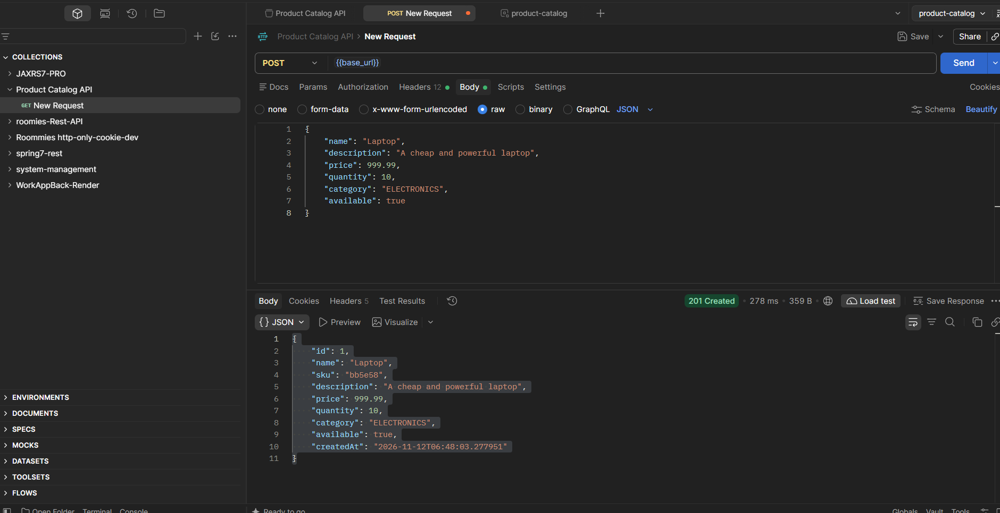
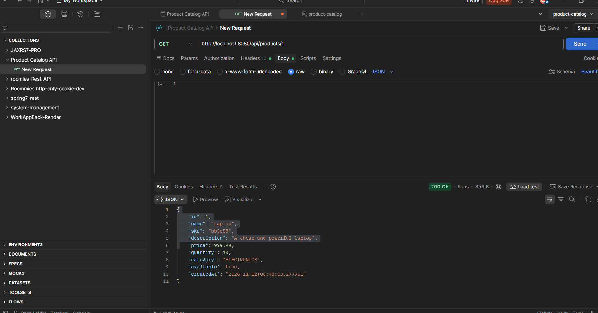
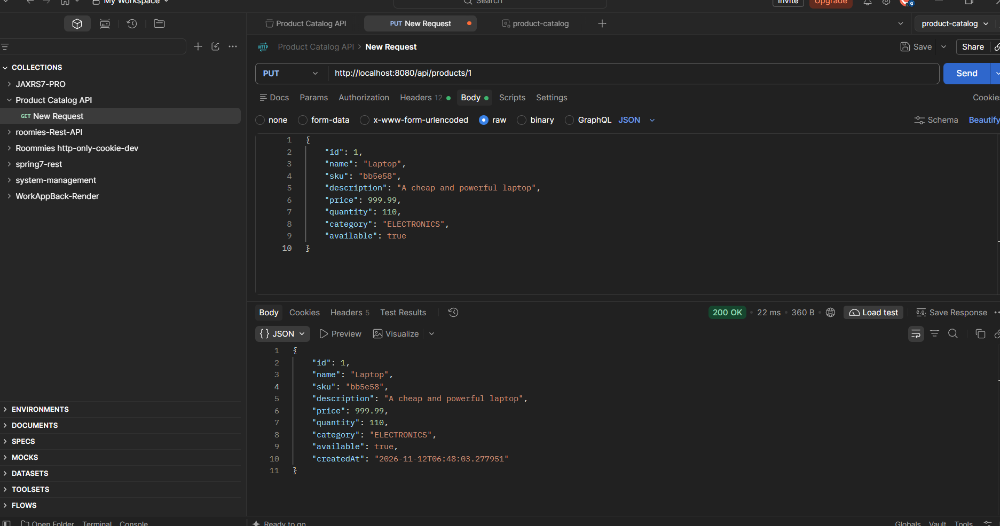
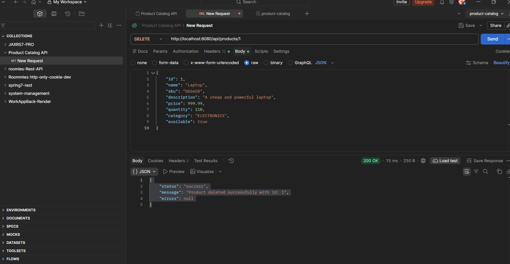
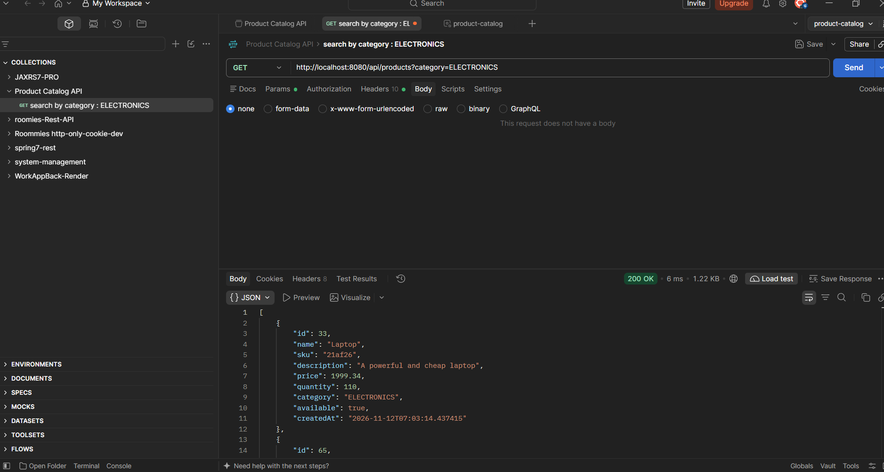
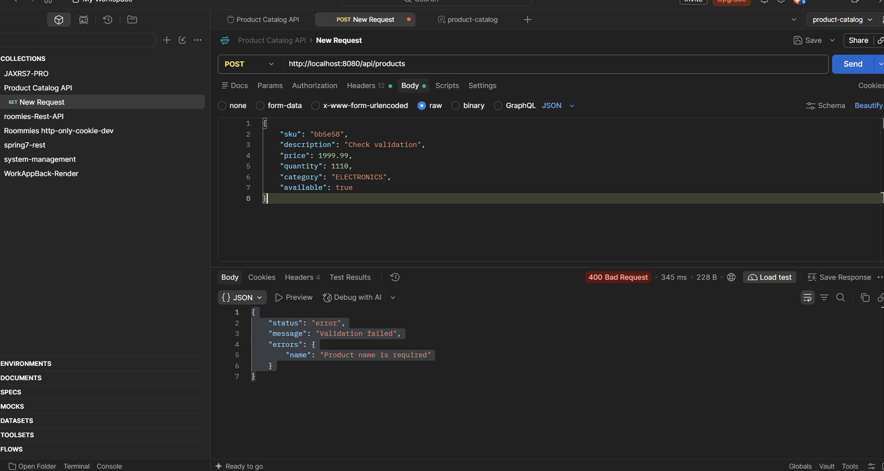
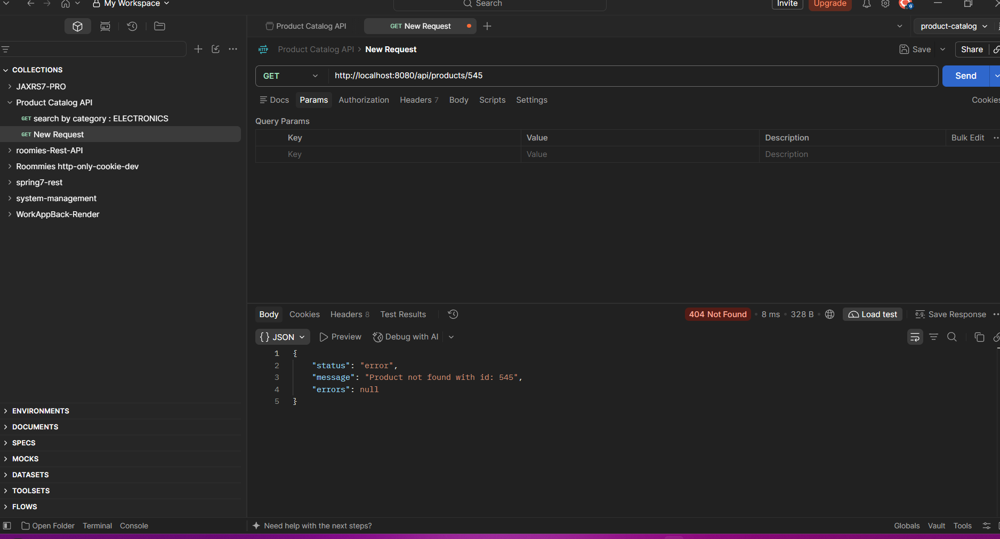
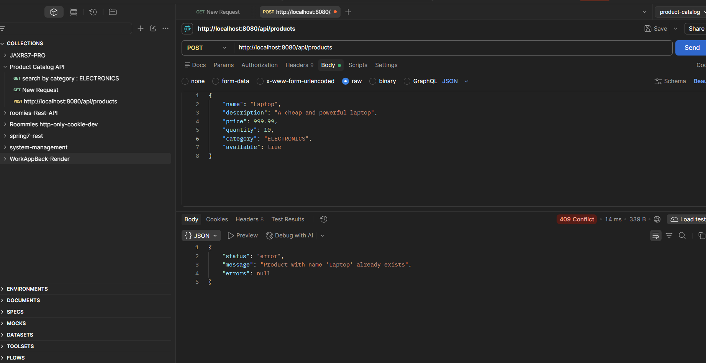
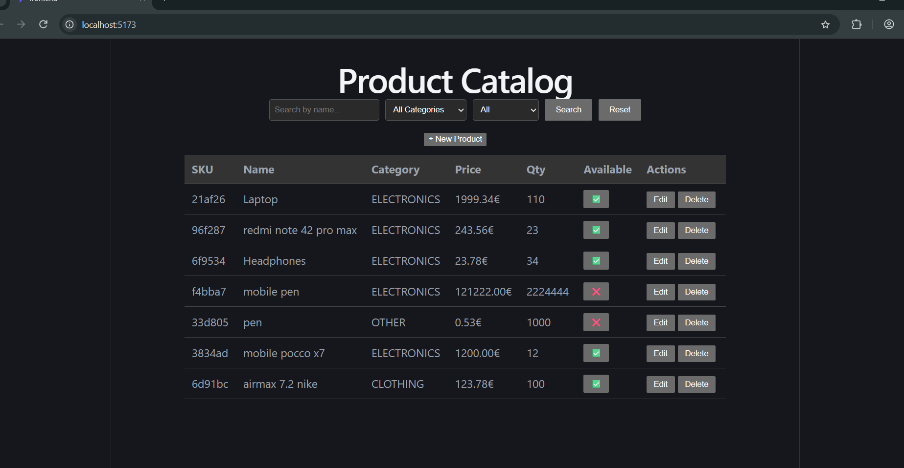
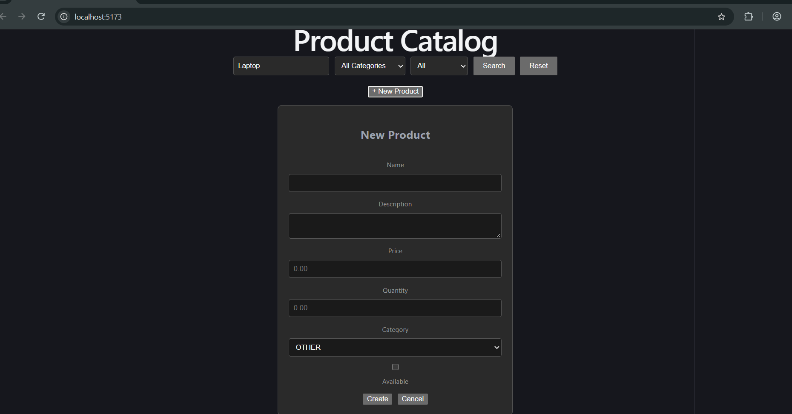

# Product Catalog

A full-stack product catalog management application built as a coding exercise.

## Tech Stack

**Backend:** Java 21, Spring Boot 4.0.9, H2 Database, Gradle  
**Frontend:** React 19, TypeScript, Vite, Axios

## Prerequisites

- Java 21+
- Node.js 18+
- npm

## Run Backend

```bash
./gradlew bootRun
```

Backend runs at `http://localhost:8080`

## Run Frontend

```bash
cd frontend
npm install
npm run dev
```

Frontend runs at `http://localhost:5173`

## Run Tests

```bash
./gradlew test
```

## API Endpoints

| Method | Endpoint | Description |
|--------|----------|-------------|
| GET | /api/products | Search/filter products |
| GET | /api/products/{id} | Get product by ID |
| POST | /api/products | Create product |
| PUT | /api/products/{id} | Update product |
| DELETE | /api/products/{id} | Delete product |

**Query parameters:** `?search=`, `?category=`, `?available=`, `?sku=`

## Screenshots

### API (Postman)

**POST /api/products ➡️ 201 Created**



**GET /api/products/{id} ➡️ 200 OK**



**PUT /api/products/{id} ➡️ 200 OK**



**DELETE /api/products/{id} ➡️ 200 OK**



**GET /api/products?category= ➡️ 200 OK**



**POST /api/products (missing name) ➡️ 400 Bad Request**



**GET /api/products/{id} (not found) ➡️ 404 Not Found**



**POST /api/products (duplicate name) ➡️ 409 Conflict**



### Frontend

**Product List-Search Bar**



**New Product Form (insert product)**



## Technical Notes

- Single `@Query` with optional parameters for combined search/filter
- Record-based DTOs with Jakarta validation
- Centralized error handling via `@RestControllerAdvice`
- UUID-based SKU auto-generation
- CORS configured for frontend dev server
- Integration tests with `@SpringBootTest` and `MockMvc`